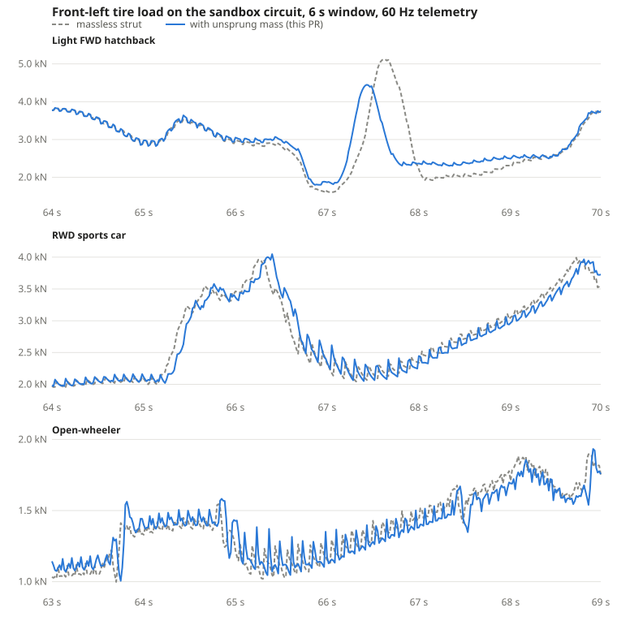

# Unsprung mass in the presets

2026-10-23. ADR-0028 added unsprung mass as an option, off by default. This
change turns it on in the six presets and reports what moved.

## Values

Typical of each class, not of a specific car: wheel, tire, brake, hub and
about half of each link per corner, with the tire about ten times as stiff
as the suspension spring, so the wheel hops at 10 to 15 Hz (Gillespie,
_Fundamentals of Vehicle Dynamics_, ch. 5). Each data sheet marks them
[ILLUSTRATIVE].

| Preset       | Unsprung mass per wheel, front / rear | Tire rate      | Tire damping |
| ------------ | ------------------------------------- | -------------- | ------------ |
| Hatchback    | 35 / 30 kg                            | 220 kN/m       | 500 N·s/m    |
| Sports car   | 40 / 42 kg                            | 280 kN/m       | 600 N·s/m    |
| Crossover    | 55 / 55 kg                            | 320 kN/m       | 700 N·s/m    |
| Open-wheeler | 22 / 25 kg                            | 250 / 260 kN/m | 400 N·s/m    |
| Kart         | 4 kg front, rear massless             | 80 kN/m        | 150 N·s/m    |
| Pickup       | 60 kg front, rear massless            | 320 kN/m       | 700 N·s/m    |

The kart's and the pickup's rears are solid axles, which do not take
unsprung mass yet.

## A core fix the presets found

With the option on, the open-wheeler hopped its wheels off the ground at a
250 Hz substep and its understeer gradient moved from 0.64 to 1.44 deg/g;
the hatchback did not quite come to rest after its locked-wheel stop. The
first version gave each wheel only the body's heave, and stepped each strut
against the wheel's mass alone. The exact-answer checks are pure heave and
could not see it; a body whose wheels carry much of its roll inertia (the
open-wheeler's carry more than half of its 90 kg·m²) did. Each wheel now
takes its own corner's acceleration from the sprung body's heave, roll and
pitch, and each strut is stepped against the reduced mass of its wheel and
that corner. ADR-0028 and `docs/validation/analytic.md` have the details;
`unsprung_tests.rs` gains a check that the open-wheeler gives the same
gradient at 250 Hz as at 1 kHz, and validation now keeps a tenth of the roll
and pitch inertias for the body. Every preset is stable across the timestep
grid.

## What moved in the validation results

| Preset       | Understeer gradient | Step-steer roll at 80 km/h | Step-steer overshoot | 100–0 km/h    |
| ------------ | ------------------- | -------------------------- | -------------------- | ------------- |
| Hatchback    | 1.08 → 1.07 deg/g   | 1.23° → 1.51°              | 4.3 → 4.1 %          | 46.5 → 46.6 m |
| Sports car   | 0.71 → 0.71 deg/g   | 0.65° → 0.83°              | 0.5 → 0.4 %          | 38.7 → 38.7 m |
| Kart         | −0.21 → −0.27 deg/g | 0.05° → 0.06°              | 1.9 → 1.4 %          | 58.0 → 58.0 m |
| Pickup       | 0.94 → 0.86 deg/g   | 1.48° → 1.74°              | 2.5 → 1.6 %          | 52.1 → 52.2 m |
| Crossover    | 0.29 → 0.28 deg/g   | 0.86° → 1.12°              | 0.3 → 0.3 %          | 44.5 → 44.6 m |
| Open-wheeler | 0.64 → 0.65 deg/g   | 0.11° → 0.16°              | 0.0 → 0.0 %          | 24.0 → 24.0 m |

- **Roll grows by 20 to 45 %.** The massless strut had rigid tires. The
  tires' vertical rate now sits in series with the springs and bars, so the
  body rolls more for the same lateral acceleration, as a real car does.
- **The pickup and the kart understeer less.** Only their independent fronts
  gained tire compliance; their solid rears still have rigid tires. The
  front's share of roll stiffness falls, so less load transfer happens at
  the front. The solid-axle change that followed gave their rears beams with mass; see
  the README tables for the current numbers.
- **The kart no longer spins on snow** in the locked-wheel stop (it brakes on
  its rear axle only, a marginal case). It stops in 120 m instead of
  spinning to a halt in 113 m. It still spins on ice.
- **Unchanged:** 0–100 km/h times, ABS stopping distances, every lane-change
  limit, step-steer response times, every parked hold, and the timestep
  sweep, which stays stable for all six.

The determinism laps were re-recorded for all six presets. Each stays within
1.8 m of the centreline (the kart 3.15 m, as before), on a track 4.5 m
wide each side.

## On the sandbox circuit

The sandbox circuit's path follower drove each car for 70 s on the Rapier
circuit mesh with and without the option, reading telemetry at the 60 Hz
host step. "Roughness" is the RMS frame-to-frame second difference, the
measure the circuit drive test uses.

| Preset       | Tire load roughness (FL) | Lateral accel roughness | Steering torque roughness | Peak tire deflection |
| ------------ | ------------------------ | ----------------------- | ------------------------- | -------------------- |
| Hatchback    | 25 → 65 N                | 0.042 → 0.045 m/s²      | 0.089 → 0.093 N·m         | 30 mm                |
| Sports car   | 59 → 99 N                | 0.051 → 0.054 m/s²      | 0.091 → 0.105 N·m         | 21 mm                |
| Open-wheeler | 117 → 77 N               | 0.079 → 0.076 m/s²      | 0.138 → 0.179 N·m         | 18 mm                |

The road cars' tire loads now ripple over the circuit's crests and kerbs,
which is the point of the change; lateral acceleration moves by under
10 %. The open-wheeler's load gets smoother: its stiff springs used to put
every ripple of the mesh straight into the load, and the tire's own
compliance now filters it.

## Solid rears (the following change)

Once solid axles could carry a beam with mass (ADR-0028), the kart and the
pickup got their rears:

- **Kart:** a 6 kg-a-wheel live axle with a roll inertia of 2.5 kg·m²,
  about 0.55 of its mass at the wheels.
- **Pickup:** a 78 kg-a-wheel live axle with 65 kg·m², about 0.58 of its
  mass at the wheels.

With tire compliance at both ends again, the front's share of roll
stiffness comes back:

| Preset | Understeer gradient: massless / fronts only / both | Step-steer roll |
| ------ | -------------------------------------------------- | --------------- |
| Kart   | −0.21 / −0.27 / −0.16 deg/g                        | 0.05° → 0.08°   |
| Pickup | 0.94 / 0.86 / 0.93 deg/g                           | 1.48° → 1.86°   |

The kart spins in the locked-wheel stop on snow again, as it did without
unsprung mass. The four cars with independent rears are unchanged bit for
bit.
